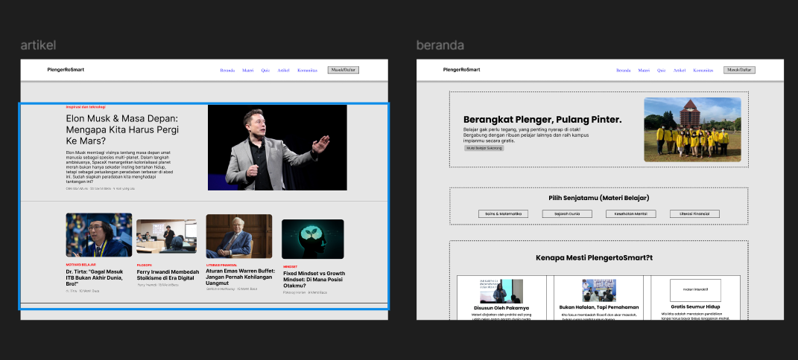

# PlengeRoSmart — Wireframe Desain

Repositori ini berisi desain **wireframe** untuk **PlengeRoSmart**, sebuah platform belajar online gratis dengan tagline **"Berangkat Plenger, Pulang Pinter."** Platform ini dibuat untuk siapa pun yang ingin belajar tanpa ribet: nyerap ilmu santai, tapi tetap berbobot, dan membantu pengguna meraih impian kampus secara gratis.

## 🔗 Prototype

Lihat prototype interaktif di Figma:
[PlengeRoSmart — Figma Prototype](https://www.figma.com/proto/aweYlXcxXzC7zU4svhwF2i/wiframe-radit-kapin?node-id=15-2&t=Z3aJHksNHKjcMpGm-1&scaling=min-zoom&content-scaling=fixed&page-id=0%3A1)

## 🖼️ Preview

## 📄 Halaman yang Sudah Dibuat

### 1. Beranda
Halaman utama yang memperkenalkan platform dengan struktur:

- **Hero section**: headline "Berangkat Plenger, Pulang Pinter." lengkap dengan deskripsi singkat, tombol CTA **Mulai Belajar Sekarang**, dan foto pendukung.
- **Pilih Senjatamu (Materi Belajar)**: pilihan kategori materi:
  - Sains & Matematika
  - Sejarah Dunia
  - Kesehatan Mental
  - Literasi Finansial
- **Kenapa Mesti PlengeRoSmart?**: tiga poin keunggulan:
  - **Disusun Oleh Pakarnya**: materi dirujuk dari praktisi dan ahli di bidangnya.
  - **Bukan Hafalan, Tapi Pemahaman**: fokus pada konsep dan cara berpikir.
  - **Gratis Seumur Hidup**: semua materi bisa diakses tanpa biaya.

### 2. Artikel
Halaman kumpulan artikel dengan layout editorial:

- **Artikel utama (featured)** di bagian atas dengan gambar besar, kategori, judul, ringkasan, penulis, dan estimasi waktu baca.
- **Daftar artikel lainnya** dalam bentuk kartu dengan kategori seperti *Motivasi Belajar*, *Filosofi*, *Literasi Finansial*, dan *Mindset*.

### Navigasi (Navbar)
Navbar konsisten di semua halaman:

`Beranda` · `Materi` · `Quiz` · `Artikel` · `Komunitas` · `Masuk/Daftar`

## 📁 Isi Repositori

| File | Keterangan |
| --- | --- |
| `wiframe_radit.fig` | File desain asli Figma (bisa dibuka dan diedit di Figma) |
| `wiframe_radit.zip` | Arsip berisi file `.fig` yang sama |
| `yuhu.png` | Preview/screenshot halaman Artikel dan Beranda |
| `README.md` | Dokumentasi ini |

## 🛠️ Cara Membuka File Desain

1. Buka [Figma](https://www.figma.com/).
2. Klik **File → Import** (atau drag & drop) lalu pilih `wiframe_radit.fig`.
3. Atau, langsung buka link prototype di atas untuk melihat alurnya tanpa import.

## 📝 Catatan

- Ini masih berupa **wireframe** (low-fidelity), jadi fokusnya di struktur dan tata letak, belum final dari sisi warna, tipografi, dan visual.
- Konten dan gambar yang dipakai bersifat placeholder untuk kebutuhan desain.

